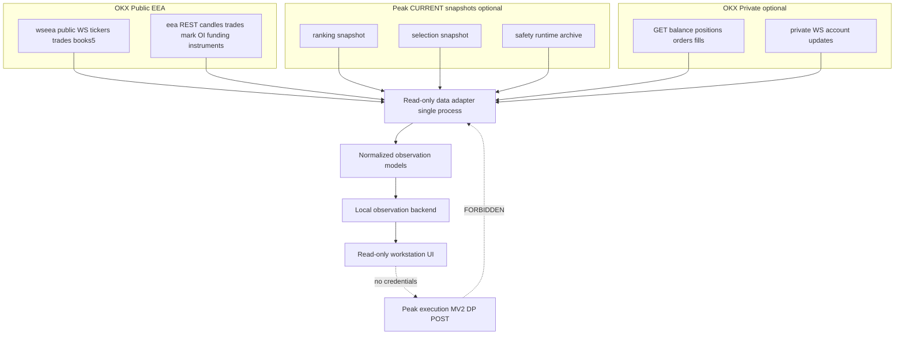

# LOCAL_OBSERVATION_WORKSTATION_ARCHITECTURE_V1

```text
DOCUMENT_CLASS=ARCHITECTURE_PROPOSAL_ONLY
IMPLEMENTATION=FORBIDDEN_UNTIL_OWNER_GO
AUTHORITY_EFFECT=NONE
RUNTIME_AUTHORIZATION_EFFECT=NONE
BASELINE=V6H + CURRENT Peak Trade WP-A / WP-B specs (navigation)
```

## 1. Problem statement (evidence-backed)

Native OKX Safari (V6B–V6F) cannot deliver a **persistent**, **trading-free** workstation with **parallel order book and time & sales** and integrated ranking. Peak Trade **Landscape V2** is a **read-only consumer** for ranking, OHLCV, and system observability, but it is **not** a full OKX terminal replacement and does **not** expose live depth + T&S columns together.

**Strategic direction:** a **local read-only workstation** that consumes **authorized data only** and never holds trading authority.

---

## 2. Target layout (Phase 5)

| Zone | Content | Primary source (proposed) |
|------|---------|---------------------------|
| **Left** | Instrument ranking Top 20; Top 5 emphasized; current Peak-Trade selected instrument | Peak `productive_futures_ranking_snapshot_v1` + `single_selected_future_selection_v1` via **isolated read-only adapter** (stale guards) |
| **Center** | Large chart; multiple intervals; volume | OKX public REST candles + optional WS; or TradingView widget on public symbol |
| **Right (top)** | Order book (≥5 levels; extend to `books` if approved) | OKX public WS `books5` or `books` |
| **Right (bottom)** | Time & sales stream | OKX public WS `trades` |
| **Right (meta)** | Funding rate, open interest, mark/index | OKX public REST `/api/v5/public/funding-rate`, `/api/v5/public/open-interest` and/or ticker fields |
| **Bottom strip** | Positions, open orders, PnL | **Branch A:** WP-B private GET/WS observation (server-side). **Branch B:** Peak `productive_portfolio_state_v1` (**labeled INTERNAL_SIMULATED**, not OKX) |
| **Bottom strip** | Runtime status, safety, rejected/positive trades | Peak Landscape archive projections / DDO exports — **only if bound with freshness**; else `UNAVAILABLE` |

**Explicit exclusions:** order forms, buy/sell, margin controls, transfers, API key UI in browser.

---

## 3. Data flow



---

## 4. Normalized observation models (sketch)

- `InstrumentRefV1` — reuse semantic alignment with `peak_trade_public_market_data_runtime_v1/facts_v1.py` (no runtime import required at implement time).
- `BookSnapshotV1` — bids/asks levels, sequence, captured_at, stale flag.
- `TradePrintV1` — price, size, side, trade_id, ts.
- `OhlcvBarV1` — interval, OHLCV, confirm state.
- `FundingSnapshotV1` / `OpenInterestSnapshotV1`.
- `PeakRankingRowV1` / `PeakSelectionV1` — **source_tag=PEAK_INTERNAL**.
- `AccountPositionV1` / `AccountOrderV1` / `AccountPnlV1` — **source_tag=OKX_PRIVATE_OBSERVATION** or absent.

Every record carries: `freshness`, `provenance`, `availability`, `fail_closed_reason`.

---

## 5. Security architecture (binding)

| Control | Mechanism |
|---------|-----------|
| No trading | Adapter HTTP method = GET only; WS ops = subscribe/ping only |
| No order POST | Path denylist; WP-B mutation flags must remain false |
| No credentials in browser | UI talks only to localhost backend |
| No Peak runtime control | Adapters do not invoke `run_current_productive_governed_cycle_v1` or orchestrators |
| UNKNOWN data | Render `UNAVAILABLE`; do not synthesize |
| Double Play / Master V2 | Read-only snapshots only; no feedback into decision loop |

Private observation uses credential class **`OKX_EEA_PRIVATE_OBSERVATION_READ_V1`** per WP-B spec — **activation is a separate Owner-GO** (not part of this charter execution).

---

## 6. Options comparison (summary)

| Criterion | Native OKX | Hybrid | Local read-only |
|-----------|------------|--------|-----------------|
| Visual quality vs owner goal | Fail | Partial | Target pass |
| OB + T&S parallel | No | No on main surface | Yes (by design) |
| Safety (no mis-click trade) | Policy only | Policy only | Stronger (no form) |
| Data freshness | Excellent | Excellent on terminal tab | Depends on adapter |
| Persistence of layout | Poor for observation | Poor | Local UI state |
| Cost | Low | Low | Medium (engineering) |
| OKX UI drift risk | High | Medium | Low for shell |
| Peak trading authority separation | N/A | Good if isolated | Good with labeled adapters |

**Decision:** **LOCAL_READ_ONLY_WORKSTATION** as target; **HYBRID** only as interim (Safari bookmarks + Landscape `/market` + no layout experiments).

---

## 7. Minimal implementation plan (no code in V1 charter)

1. **M0** — Ratify charter + allowlists (this document set).
2. **M1** — Owner decision: exchange-blind public-only vs WP-B account panel.
3. **M2** — Freeze normalized schema v1 and freshness SLAs.
4. **M3** — (Future GO) Public-only adapter process + smoke against EEA endpoints.
5. **M4** — (Future GO) UI shell with chart + OB + T&S columns.
6. **M5** — (Future GO) Peak snapshot + optional WP-B integration behind server.

---

## 8. Technical blockers

- **Host policy:** unify `eea.okx.com` vs `www.okx.com` for REST in one adapter policy.
- **Depth:** WP-A binds `books5` only; full book needs explicit `books` channel approval.
- **Funding/OI:** fact types exist; not all paths on narrow `OkxPublicMarketDataClientV1` allowlist — adapter must extend deliberately without POST.
- **Semantic drift:** Peak `productive_portfolio_state_v1` is **simulated** in Cap 7.2 mode — must never be labeled as OKX exchange truth.
- **Rejected/positive trades:** no CURRENT unified live feed proven — fail-closed until producer identified.
- **TradingView embed:** licensing/ToS **UNKNOWN**.

---

## 9. References (CURRENT navigation)

- `docs/ops/specs/PEAK_TRADE_PUBLIC_MARKET_DATA_RUNTIME_V1.md`
- `docs/ops/specs/OKX_EEA_PRIVATE_ACCOUNT_STATE_RUNTIME_V1.md`
- `src/ops/okx_public_market_data_client_v1.py`
- `src/ops/peak_trade_public_market_data_runtime_v1/ws_binding_v1.py`
- `src/webui/market_dashboard_landscape_v2/` + completion census V1
- `config/runtime/single_future_stateful_no_order_runtime_activation_v1.json`
- V6H evidence: `evidence/ops/okx_maximum_observation_workstation_v6/20261016T093600Z_v6h/`
